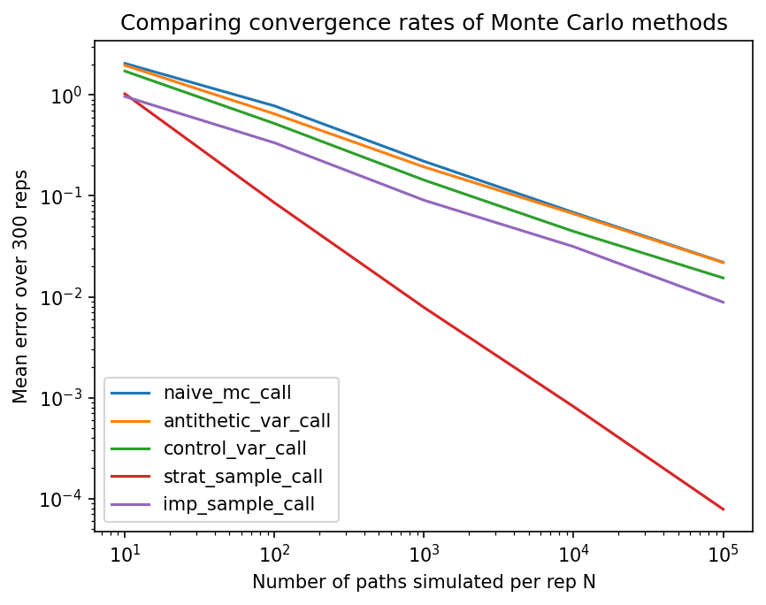

# Options Pricer

Monte Carlo pricing of European call options, with four variance reduction techniques implemented and benchmarked against each other and against the closed-form Black-Scholes price.


# Overview

A naive Monte Carlo estimator for an option price converges at rate O(N^-1/2), which is slow. Cutting the standard error in half requires four times as many paths. This project implements and compares four variance reduction techniques that improve on naive Monte Carlo without introducing bias:

- Antithetic variates
- Control variates
- Stratified sampling
- Importance sampling

Each estimator is vaidated against the Black-Scholes closed-form price and benchmarked on accuracy, variance, and computational efficiency.


# Background

The underling asset's price follows Geometric Brownian Motion:

$$S(T) = S_0 \exp\left[\left(r - \tfrac{1}{2}\sigma^2\right)T + \sigma\sqrt{T}Z\right], \qquad Z \sim N(0,1)$$

The discounted call payoff is $e^{-rT}\max(S(T) - K, 0)$, and its expectation under the risk-neutral measure is the option price. All five estimators below estimate this same expectation; they differ only in how $Z$ is sampled or how the estimator is post-processed to reduce variance.


### Naive Monte Carlo

Draws $Z_1, \dots, Z_N \sim N(0,1)$ directly and averages the discounted payoffs. This is the baseline against which every other method is judged.

### Antithetic variates
 
Each draw $Z_i$ is paired with $-Z_i$, and the two resulting payoffs are averaged before being added to the sample. Since $S(T)$ is a monotonic function of $Z$, this pairing induces negative correlation between the two payoffs, which reduces the variance of their average relative to two independent draws.

### Control variates
 
Uses $S(T)$ itself as a control variate, since $\mathbb{E}[S(T)] = S_0 e^{rT}$ is known in closed form. The estimator is adjusted as:
 
$$\hat{C}_{cv} = \hat{C} - c\left(S(T) - S_0 e^{rT}\right)$$
 
with $c$ chosen to minimise variance ($c = \text{Cov}(\text{payoff}, S(T)) / \text{Var}(S(T))$, estimated from the sample). This works well because the payoff is highly correlated with $S(T)$ for in-the-money paths.

### Stratified sampling
 
Partitions $(0,1)$ into $N$ equal-probability strata and draws exactly one uniform sample from each, then maps through the inverse normal CDF. This guarantees even coverage of the sample space and removes the sampling variance that comes from paths clustering by chance, which is the dominant source of variance in the naive estimator.


## Results
 
Parameters used throughout: $S_0 = 100$, $K = 120$, $T = 1$, $r = 0.05$, $\sigma = 0.2$ ($K/S_0 = 1.2$, i.e. an out-of-the-money call). Black-Scholes price: **3.2475**.

All figures below are averaged over 300 independent repetitions at $N = 1000$ paths per repetition.

**Accuracy and variance**

| Method | Mean price | Mean error | Variance |
|---|---|---|---|
| Naive Monte Carlo | 3.2538 | 0.2201 | 0.0746 |
| Antithetic variates | 3.2537 | 0.1935 | 0.0582 |
| Control variates | 3.2402 | 0.1434 | 0.0324 |
| Stratified sampling | 3.2475 | 0.0078 | 0.0001 |
| Importance sampling | 3.2506 | 0.0905 | 0.0132 |

**Efficiency relative to naive (higher is better; efficiency = variance * runtime)**

| Method | Mean time | Efficiency (rel. to naive) |
|---|---|---|
| Naive Monte Carlo | 0.000040 | 1.05 |
| Antithetic variates | 0.000046 | 1.18 |
| Control variates | 0.000093 | 1.05 |
| Stratified sampling | 0.00014 | 206.8 |
| Importance sampling | 0.000050 | 4.71 |

Note that the runtimes are so short that there are small variations, e.g. Naive Monte Carlo has efficiency 1.05 relative to itself, when 1 would be expected.

For this out-of-the-money strike, stratified sampling dominates by a wide margin. It removes uneven coverage of the sample space - a variance contribution that all other methods leave untouched. Antithetic and control variates give modest, near free improvements at essentially the same runtime as naive Monto Carlo. Their small runtime overhead is not worth it in this case, since the variance reduction they achieve is also modest, so the net efficiency comes out close to naive.

**Stratified sampling only works this well because the problem is one-dimensiona.** A European call under GBM depends on a single terminal draw $Z$, so stratifying that one dimension gives complete coverage of the distribution with $N$ strata and $N$ paths, at essentially no extra cost. However, this does not generalise to path dependent options which require many correlated draws per simulated path, or to multi-asset payoffs. Stratifying $d$ dimensions while preserving the same coverage guarantee requires on the order of $N^d$ strata, so the approach becomes impractical quickly as dimension grows. This is an example of the curse of dimensionality.

**A note on standard errors.**
NEED TO ADD


**Convergence**



All methods converge to the Black-Scholes price as $N$ grows, but at different rates. The mean error shrinks at $O(N^-1/2)$ for naive Monte Carlo, antithetic variates, control variates, and importance sampling, but at $O(N^-1)$ for stratified sampling.

This plot is regenerated by benchmarks.py.


# Project structure

```
.
├── main.py          # Black-Scholes formula and the five Monte Carlo estimators
├── benchmarks.py     # Benchmarks for variance, error, convergence, efficiency
├── requirements.txt
└── README.md
```


# Usage

To use an estimator directly:
 
```python
import numpy as np
from main import strat_sample_call
 
rng = np.random.default_rng(seed=0)
price, payoffs = strat_sample_call(S0=100, K=120, T=1, r=0.05, sigma=0.2, N=1000, rng=rng)
```